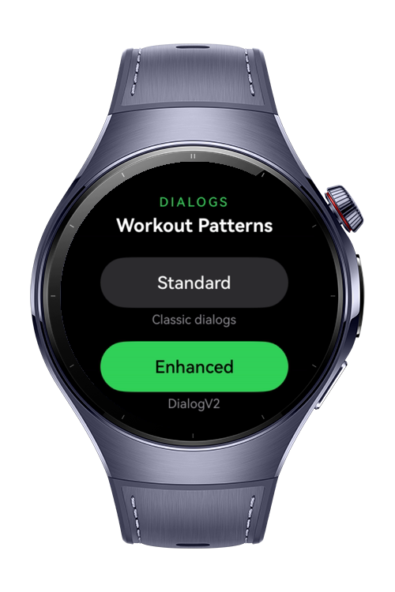
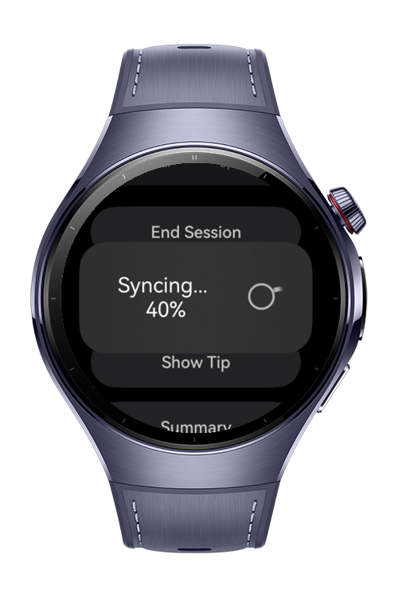
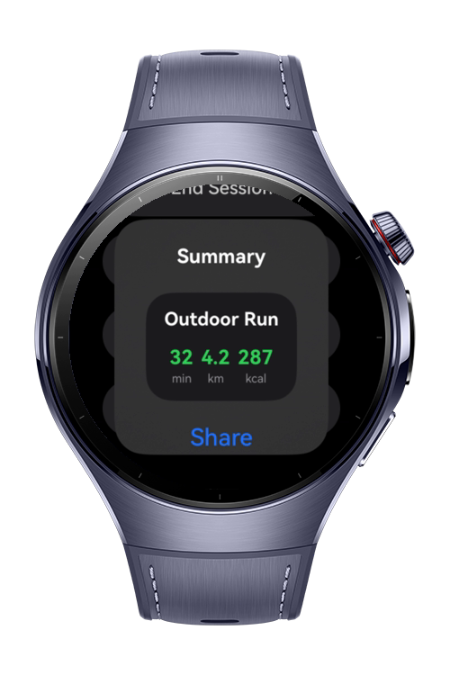
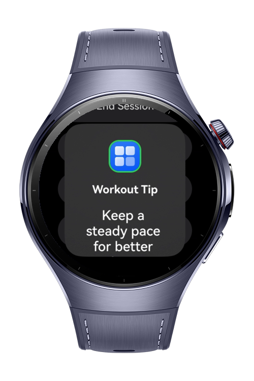

> **Note:** To access all shared projects, get information about environment setup, and view other guides, please visit [Explore-In-HMOS-Wearable Index](https://github.com/Explore-In-HMOS-Wearable/hmos-index).

# How to Build Loading Confirm Dialog

The `how-to-build-loading-confirm-dialog` codelab demonstrates standard ArkUI dialog components and their DialogV2 counterparts on HarmonyOS wearables.

A watch-friendly ArkUI sample that showcases `ConfirmDialog`, `LoadingDialog`, and `TipsDialog` alongside `ConfirmDialogV2`, `LoadingDialogV2`, `TipsDialogV2`, and `CustomContentDialogV2` through a shared workout-session scenario. The implementation allows developers to compare traditional dialog patterns with DialogV2 implementations while following wearable UI design principles.

# Preview

<div>
  
  
  
  
</div>

# Use Cases

* **Standard vs enhanced comparison**: compare traditional ArkUI dialogs and DialogV2 implementations using the same workout-session scenario.
* **End-workout confirmation**: confirm ending a workout session before executing the action with `ConfirmDialog` and `ConfirmDialogV2`.
* **Workout synchronization feedback**: display loading indicators during workout synchronization using `LoadingDialog` and progress-based `LoadingDialogV2`.
* **Workout guidance tips**: present informational workout guidance with images and actions through `TipsDialog` and `TipsDialogV2`.
* **Custom workout summary dialogs**: build fully customized workout summary dialogs using `CustomContentDialogV2` and `contentBuilder`.
* **Shared workout data**: supply identical workout session data to both pages through `MockWorkoutProvider` for direct feature comparison.
* **Dialog presentation management**: demonstrate centralized DialogV2 presentation and dismissal using `DialogController`.
* **Wearable-friendly layouts**: implement dialog interactions optimized for round watch displays and compact scrolling pages.
* **Consistent dialog sizing**: apply shared dialog dimensions across DialogV2 implementations while allowing loading dialogs to size automatically.

# Tech Stack

* **Languages**: ArkTS / ArkUI
* **Frameworks**: HarmonyOS SDK 6.0.1(21)
* **Tools**: DevEco Studio, Hvigor
* **Libraries**:

    * `@kit.ArkUI`

        * ConfirmDialog
        * LoadingDialog
        * TipsDialog
        * ConfirmDialogV2
        * LoadingDialogV2
        * TipsDialogV2
        * CustomContentDialogV2
        * CustomDialogController

# Directory Structure

```
entry/src/main/
├── ets/
│   ├── entryability/
│   │   └── EntryAbility.ets
│   ├── entrybackupability/
│   │   └── EntryBackupAbility.ets
│   ├── theme/
│   │   └── AppTheme.ets
│   ├── model/
│   │   └── WorkoutSession.ets
│   ├── provider/
│   │   └── MockWorkoutProvider.ets
│   ├── components/
│   │   └── WorkoutSessionCard.ets
│   ├── controller/
│   │   └── DialogController.ets
│   └── pages/
│       ├── Index.ets
│       ├── StandardDialogsPage.ets
│       └── EnhancedDialogsPage.ets
├── resources/
│   └── base/
│       └── profile/
│           └── main_pages.json
└── module.json5
```

# Constraints and Restrictions

## Supported Devices

* Huawei Watch 5

## Limitations

* DialogV2 components require API Version 18 or later.

# License

How to Build Loading Confirm Dialog is distributed under the terms of the MIT License.

See the [LICENSE](LICENSE) file for more information.